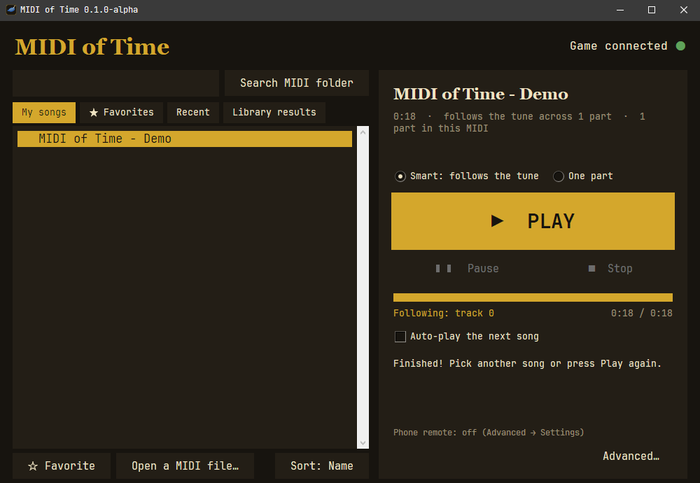

# MIDI of Time

**Load a MIDI file, press Play, and Link performs it on his own Ocarina** in the *Ocarina of Time* remake running in a compatible emulator.

MIDI of Time does not play any audio of its own. It sends controller input to the emulator, and the game's real Ocarina makes the sound. That includes notes, sharps and flats, slurs, pitch bends and vibrato.

[](https://www.youtube.com/watch?v=Uw753Ddfy60)

▶ **[Watch the demo: Link plays Dr. Wily Stage 1 (Mega Man 2)](https://www.youtube.com/watch?v=Uw753Ddfy60)**

> **Alpha release (v0.1.0-alpha).** It works well on the setup it was developed on (see [Compatibility](#compatibility)). Expect rough edges, and please report what you find.



---

## Features

- **One-click playback:** pick a song, press **PLAY**. Pause, Resume, Stop, a progress bar and auto-play of the next song are included.
- **Controller kill switch:** press **D-pad left or right** on your controller during a song (putting the Ocarina away, or opening the song menu) and playback stops instantly, releasing every button. Needs an XInput controller (Xbox-style; most modern pads).
- **Controller shortcuts while a song is playing or paused:** D-pad up = pause / resume (resumes at the note you paused on), D-pad down = stop. They never start a song. The bumpers/triggers still shift the whole song a half step, as in the game.
- **Smart mode** (default) follows the tune across a MIDI's parts. When the melody moves from flute to violin to trumpet, Link follows it. It also fills short pauses from whichever part is still playing.
- **One part mode** plays a single track that you choose.
- **Fits songs to Link's range:** whole phrases move by octaves into the Ocarina's range (about C5 to E6), so runs keep their shape.
- **Expressive playing:**
  - Connected notes slur without re-attacking.
  - MIDI pitch bend and the mod wheel (vibrato) are used.
  - **Smart breathing:** the game silences the Ocarina about 6.8 s after the last real breath. MIDI of Time places a short breath (4 frames, ~0.13 s) before that happens, at the most musical spot nearby, without changing the song's timing.
  - Each note is tuned with the stick to correct the instrument's built-in pitch offsets.
- **Songs folder** next to the program. You can also open any MIDI file directly, or search your whole MIDI folder (instant if [Everything](https://www.voidtools.com/) is installed).
- **Favorites, Recent, and sort by name or size.**
- **Advanced settings:** which part to play, gap-fill part, tuning, slurs, vibrato, speed, transpose and start point. You can save any of these as a song's default.
- **Optional phone remote:** control playback from your phone's browser on your home Wi-Fi. It is off by default and PIN-protected.
- **Portable:** no installer and no Python needed. Unzip it and run it.
- **Built-in demo song** (original, generated by the program) for testing your setup.

## Compatibility

**MIDI of Time has been developed and tested with Fritchii only.** The one verified configuration:

| | |
|---|---|
| **Emulator** | **Fritchii v5.8.4** (Eden/Lichii fork), Windows x64 |
| **Required feature** | Its **NX2 debug server**, switched on by starting the emulator with `EDEN_NX2_DEBUG_SERVER=127.0.0.1:6545` (**Start game** in MIDI of Time does this for you) |
| **Game** | *The Legend of Zelda: Ocarina of Time* remake (your own legally obtained copy) |
| **In-game setting** | Ocarina controls: **Classic** |
| **Frame-rate mode** | 30 FPS mode. 60 FPS mode is detected automatically, but that is untested. |
| **Controller** | Connected as **Player 1** (you don't touch it while Link plays) |
| **OS** | Windows 10 / 11, 64-bit |

The app checks the emulator every few seconds and shows one of these:
- **Game connected** (verified)
- **Connected (untested)**: another build that has the same debug server
- **Incompatible emulator**: for example, current zortos293 builds have the debug server but not the input command MIDI of Time needs

See **[COMPATIBILITY.md](COMPATIBILITY.md)** for the full Verified / Untested / Incompatible report.

## Quick start

**No terminal or coding needed.** Unzip it and double-click it.

1. **Download and unzip** `MIDI-of-Time-0.1.0-alpha-win64.zip` anywhere you can write to, such as your Desktop or Documents.
2. **Run `MIDI of Time.exe`.**
3. **Press "Start game"** (top right). The first time, point it at your emulator (`lichii.exe`) and, optionally, your game file. MIDI of Time starts the emulator **with the debug link switched on for that launch only**. Your emulator's settings are never changed.
   - Prefer starting the emulator yourself? See [Starting the emulator yourself](#starting-the-emulator-yourself-optional-advanced) (optional, for advanced users).
4. Load your save in the game, stand somewhere quiet, and **take out the Ocarina**. Put the controller down.
5. When the top right shows **Game connected** (green), pick **"MIDI of Time - Demo"** and press **PLAY**.
6. Add your own music, any of three ways:
   - Copy `.mid` files into the **Songs** folder next to the program. They appear under **My songs**.
   - Use **Open a MIDI file…** to play any single file.
   - Use **Search MIDI folder** to search your whole collection. The first time, the app asks which folder holds your MIDI files (subfolders included). Change it later in **Advanced… → Settings…**.

> ⚠️ **Only press Play while Link is holding the Ocarina.** The app presses real controller buttons. Anywhere else, such as a menu or normal gameplay, those presses control Link. Press **Stop**, **D-pad down**, or **D-pad left/right** on your controller at any time to stop and release everything.

### Starting the emulator yourself (optional, advanced)

The debug server is switched on by an environment variable that the emulator reads at launch. For example, in PowerShell:

```powershell
$env:EDEN_NX2_DEBUG_SERVER = '127.0.0.1:6545'; & 'C:\path\to\lichii.exe'
```

The variable only affects emulators started from that same window. The server listens on your own PC only (`127.0.0.1`).

## Phone remote (optional)

Open **Advanced… → Settings…**, tick **Phone remote**, then restart MIDI of Time. The bottom of the window shows an address such as `http://192.168.x.x:8765` and a 6-digit PIN.

1. Open that address in your phone's browser (same Wi-Fi as the PC).
2. Enter the PIN.
3. Optionally, use **Add to Home Screen**.

The remote only works on your home network. After 5 wrong PINs, that device is locked out for a minute. **New PIN** in Settings changes the PIN. Windows Firewall will ask once; allow **Private networks** only.

## How it works

1. The MIDI file is read and one melody line is chosen: Smart mode follows the tune across parts, and One part mode uses a single track.
2. Each note is mapped to a real Ocarina fingering:
   - Five base buttons
   - L/ZL for sharps and flats
   - The left stick for bends, tuning and vibrato
   This uses an instrument model measured from recordings of the game.
3. The fingerings are sent to the emulator's debug server as frame-timed controller input. The game's Ocarina plays them.

More detail: [docs/HOW-IT-WORKS.md](docs/HOW-IT-WORKS.md).

## The Ocarina Research Lab

MIDI of Time grew out of hands-on experiments with the remake's playable Ocarina. Alongside the app, this repository publishes the research behind it:
- the controller mapping
- frequency and stick-bend measurements
- the breath limit
- test methods and tools
- historical community song sources
- open questions

- [Research index](docs/research/README.md)
- [Controller buttons and pitch map](docs/research/01-controls-and-pitches.md)
- [Audio measurements and charts](docs/research/02-acoustic-measurements.md), including the 2026-11-15 breath measurement
- [How MIDI of Time performs notes](docs/research/03-midi-performance-engine.md)
- [Reproduce the tests](docs/research/04-reproduce-tests.md)
- [Historical Ocarina song sources](docs/research/05-historical-sources.md)
- [Evidence register and outstanding tests](docs/research/06-evidence-register.md)

The research notes separate **measured** results from **derived or predicted** behavior and from **unresolved** questions. Measured peaks are not certified fundamental frequencies. The validated layout is an Xbox-labelled 8BitDo Ultimate 2C with the game's **Classic** Ocarina controls on Fritchii v5.8.4, not every controller or emulator.

## Known limitations

- **Link plays one note at a time.** Chords are reduced to the top note, or to the melody in Smart mode.
- **Range is about 1.3 octaves (C5–E6).** Notes outside it move by octaves, so wide melodies can jump.
- **Breathing:** Link takes a short breath at least every ~6.3 s, so very long held notes are split, and you may hear brief breaths in fast passages.
- **The app can't detect whether the Ocarina is out.** See the warning above. The D-pad kill switch only reacts to *you* pressing D-pad left/right; if the game itself takes the Ocarina away (a cutscene, getting hit), press Stop or D-pad down.
- **Kill switch and shortcuts need an XInput controller.** Other controllers are not watched (the log says "no XInput controller found").
- **Smart mode guesses** which part carries the tune, and sometimes guesses wrong. Switch to **One part**, or choose the part in Advanced, then save it as the song's default.
- **Only Fritchii v5.8.4 is verified.** Other builds are untested or incompatible (see [COMPATIBILITY.md](COMPATIBILITY.md)).
- **Very fast passages** (faster than about 15 notes per second) skip some notes.
- **A MIDI track named `[Link]`** always wins in One part mode. Use this for arrangements you make yourself.

## Troubleshooting

See [TROUBLESHOOTING.md](TROUBLESHOOTING.md).

## Building from source

Requires Python 3.12 or newer, with tkinter. There are no third-party runtime dependencies.

```powershell
python -m pip install pyinstaller          # build only
python tests\test_offline.py               # offline tests
python -m midi_of_time                     # run from source (from the src folder)
build\build.ps1                            # makes dist\MIDI of Time\
```

## Legal

MIDI of Time is a fan-made tool. It is **not affiliated with or endorsed by Nintendo**. *The Legend of Zelda* and *Ocarina of Time* are trademarks of Nintendo.

This project contains **no Nintendo game files, no emulator files and no copyrighted music**. The included demo song is an original sequence generated by the program. Use your own legally obtained game and your own MIDI files.

License: see [LICENSE](LICENSE). Third-party components: see [THIRD_PARTY_NOTICES.md](THIRD_PARTY_NOTICES.md).

## Credits

See [CREDITS.md](CREDITS.md).
