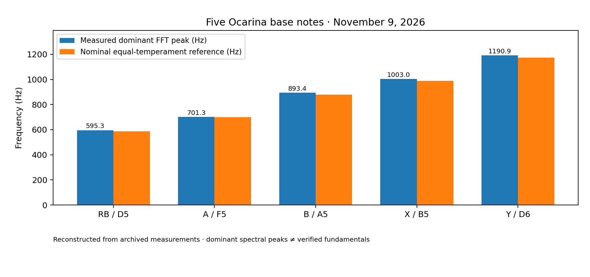
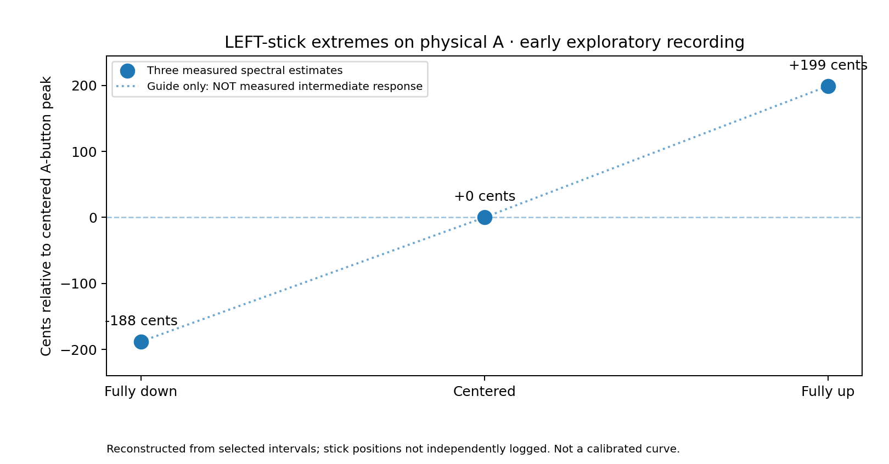
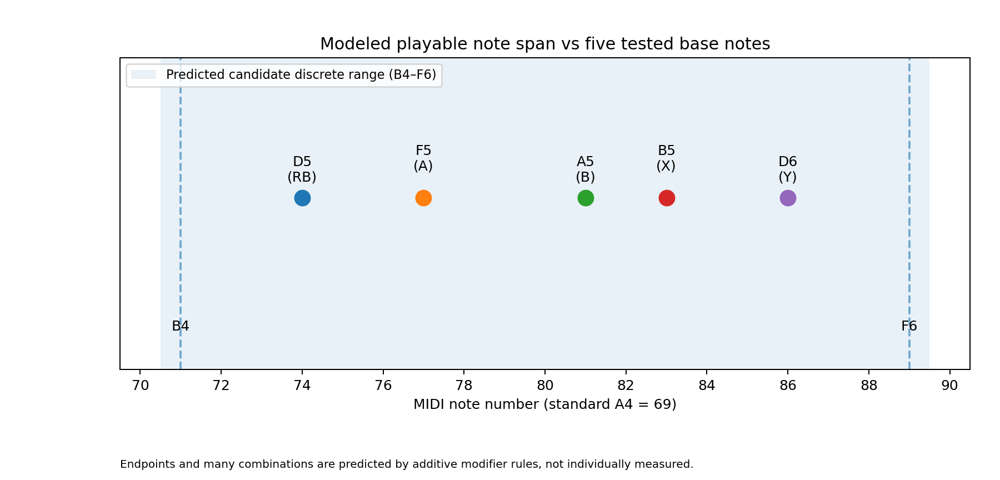

# Controls, notes and pitch modifiers

**Test context:** Xbox-labelled 8BitDo Ultimate 2C, Classic one-handed Ocarina input; Fritchii. The physical labels on the controller are different from the Nintendo-named buttons accepted by the debug-server API.

## Five normal notes

| Physical Xbox button | Nintendo/HID button | Observed/tuner pitch label | MIDI note | Nov. 9 FFT dominant peak |
|---|---|---|---:|---:|
| RB | `R` | D5 | 74 | 595.3 Hz |
| A | `B` | F5 | 77 | 701.3 Hz |
| B | `A` | A5 | 81 | 893.4 Hz |
| X | `Y` | B5 | 83 | 1003.0 Hz |
| Y | `X` | D6 | 86 | 1190.9 Hz |

These notes are **observed pitch labels** and strongest FFT peaks. The octave and slight cent offsets are *not* independently certified synthesized F0. Historical N64 tablature commonly labels the same note classes D4/F4/A4/B4/D5; preserve the difference between notation and acoustic measurements.

## Modifier behavior

| Gesture | Relative pitch | Evidence |
|---|---:|---|
| No modifier; LEFT stick centered | 0 semitones | Tested |
| LB held (`L` in HID) | +1 semitone | Tested |
| LT held (`ZL` in HID) | -1 semitone | Tested |
| LEFT stick fully up (`[0,1]`) | approximately +2 semitones | Tested; spectral estimate +199 cents on A |
| LEFT stick fully down (`[0,-1]`) | approximately -2 semitones | Tested; spectral estimate -188 cents on A |
| LB + LEFT up | approximately +3 semitones | Tested on physical A; not on all bases |
| LT + LEFT down | approximately -3 semitones | Tested on physical A; not on all bases |
| LB and LT simultaneously | LT wins (-1) | Later direct test; avoid as a generated fingering |

Stick movement between extremes can morph pitch while a single face button remains held. The RIGHT stick operates the camera, not the Ocarina's pitch.

### LEFT-stick transfer curve (measured 2026-11-14, supersedes "not fully measured")

Measured by microphone analysis of injected input (debug-server `input_sequence`, exact stick values), mean of an A5 and an F5 sweep. This is the table MIDI of Time uses (`CAL_Y` / `CAL_C` in `src/midi_of_time/engine.py`).

| Left stick Y | -1.0 | -0.75 | -0.5 | -0.25 | 0 | +0.25 | +0.5 | +0.75 | +1.0 |
|---|---:|---:|---:|---:|---:|---:|---:|---:|---:|
| Pitch change (cents) | -202 | -154 | -100 | -50 | 0 | +46 | +88 | +143 | +192 |

Status: **measured** (two bases). The curve is continuous, not stepped. The 2026-11-09 FFT extremes (-188 / +199 cents on A) agree within the expected error. The raw 2026-11-14 measurement captures are in the maintainer's working folder and are not yet published here. Horizontal stick vibrato: **unresolved**; MIDI of Time produces vibrato by modulating the vertical axis instead.

### Base-note tuning offsets (measured 2026-11-14)

Microphone analysis of each base note, as offsets from equal temperament: **R/RB = D5 +23¢, B/A = F5 +9¢, A/B = A5 +28¢, Y/X = B5 +24¢, X/Y = D6 +24¢**. These match the independent 2026-11-09 FFT peaks within a few cents (e.g. 595.3 Hz vs D5 587.33 Hz = +23¢). MIDI of Time corrects them with the stick (`BASES` in `engine.py`).

### D-pad during Ocarina play (player-tested 2026-11-15, Fritchii v5.8.4)

| D-pad | In-game binding | While a song is playing |
|---|---|---|
| Left | Take out / put away the Ocarina | Puts the Ocarina away; injected notes then drive Link around. MIDI of Time uses it as a **kill switch**. |
| Right | Talk to Navi | Opens the Ocarina song menu, interrupting playback. Also a kill switch. |
| Up / Down | unbound | No effect; MIDI of Time uses them as pause/resume and stop. |

Holding a bumper/trigger (LB/LT) during injected playback shifts the whole song a half step (the modifiers combine with injected input). Status: **tested** by the project creator.

## Candidate chromatic range / alternate fingerings

From the five tested bases and ±1/±2/±3 semitone rules, the **model predicts** nominal pitches from **B4 (MIDI 71) through F6 (MIDI 89)**. This is a modeled discrete-pitch span, *not* proof every combination has been tested. Alternate fingerings can produce the same nominal note and may be useful for smoother melodic lines.

| MIDI | Note | Candidate physical fingering | Verification caveat |
|---:|---|---|---|
| 71 | B4 | RB + LT + LEFT down | Edge: predicted |
| 72 | C5 | RB + LEFT down | Derived from tested stick rule |
| 73 | C♯5 | RB + LT | Modifier rule tested |
| 74 | D5 | RB | Base directly tested |
| 75 | D♯5 | A + LEFT down; or RB + LB | Alternate choices derived |
| 76 | E5 | A + LT | Modifier rule tested |
| 77 | F5 | A | Base directly tested |
| 78 | F♯5 | A + LB | Modifier rule tested |
| 79 | G5 | A + LEFT up; or B + LEFT down | Alternatives playtested; tuner disagreement remains |
| 80 | G♯5 | B + LT; or A + LB + LEFT up | Second choice playtested on A |
| 81 | A5 | B | Base directly tested |
| 82 | A♯5 | B + LB | Modifier rule tested |
| 83 | B5 | X | Base directly tested |
| 84 | C6 | X + LB; or Y + LEFT down | Derived alternatives |
| 85 | C♯6 | Y + LT; or X + LEFT up | Derived alternatives |
| 86 | D6 | Y | Base directly tested |
| 87 | D♯6 | Y + LB | Modifier rule tested |
| 88 | E6 | Y + LEFT up | Derived from tested stick rule |
| 89 | F6 | Y + LB + LEFT up | Edge: predicted |

## Reproducible canonical calibration tunes

These are **physical Xbox labels** in Classic mode:

- Song of Storms: `RB A Y | RB A Y`
- Saria's Song: `A B X | A B X`
- Zelda's Lullaby: `X Y B | X Y B`
- Mary Had a Little Lamb: an arrangement relying on `B + LEFT down` for G5 was reported playtested; the fully vetted source staff sequence was not available for inclusion here. Do not substitute decorative sheet-music images as machine-readable ground truth.

## Built-in songs verified in play (Classic layout)

These come from the project creator's own playtests (re-confirmed 2026-11-15). The note names follow the verified mapping above.

| Song | Physical buttons (8BitDo Ultimate 2C, Xbox labels) | Nintendo / debug names | Notes |
|---|---|---|---|
| Zelda's Lullaby | `X Y B` · `X Y B` | `Y X A` · `Y X A` | B5 D6 A5 · B5 D6 A5 |
| Saria's Song | `A B X` · `A B X` | `B A Y` · `B A Y` | F5 A5 B5 · F5 A5 B5 |
| Song of Storms | `RB A Y` · `RB A Y` | `R B X` · `R B X` | D5 F5 D6 · D5 F5 D6 |

The other built-in songs have not been checked against this layout yet, so they are left out rather than guessed.

**Withdrawn:** an AI-generated illustration of all twelve built-in songs, produced during research, has wrong button sequences and notation for this layout. It is **not** part of this documentation and must not be used as a reference. Song charts from other sources may use another control scheme or the original N64 buttons. Translate by **note**, never by button name, and check against the table above.

For developer input translation: Xbox `A→B`, `B→A`, `X→Y`, `Y→X`, `RB→R`, `LB→L`, `LT→ZL` (Nintendo/HID). The remake's RB (`R`) is a **D note** in Classic mode, **not** the original N64's `R` sharp modifier.
