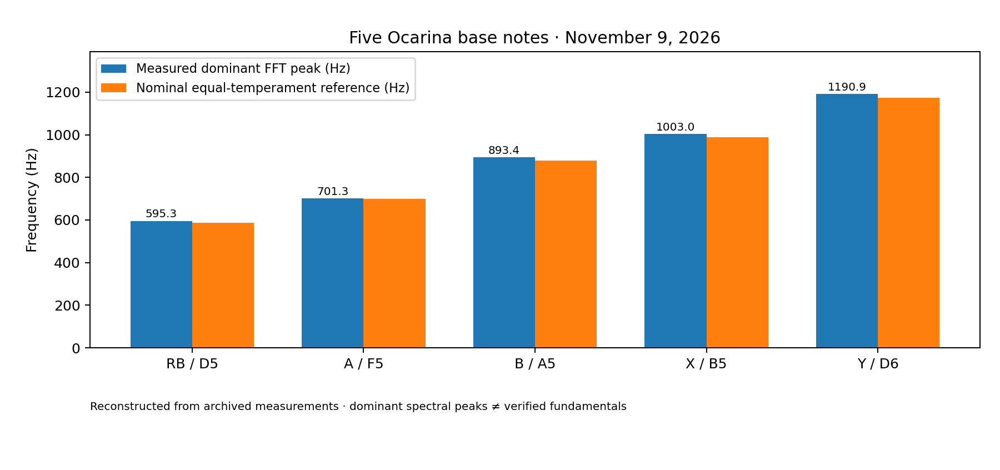
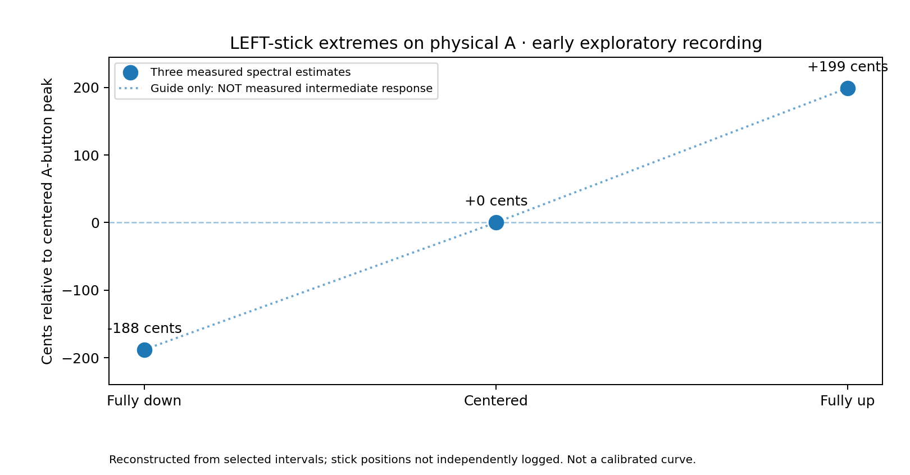

# Recorded audio measurements

The project creator performed four original OBS Ocarina recordings on **2026-11-09**. Earlier analysis used short Hann-window FFTs with energy thresholds to identify the **dominant spectral peak** in each tonal region. Such peaks are useful relative-pitch clues, but can select a harmonic rather than the fundamental; game reverb, background sounds, recording AAC compression, and vibrato add uncertainty.

## Baseline capture: five neutral notes

Source OBS file `2026-11-09_01-54-44.mp4`, approximately **38.17 s**. Played physical Xbox **A, X, Y, B, RB** as five successive neutral notes.

| Input | Approximate region in capture | Strong audio duration | Dominant FFT peak | Closest peak-label |
|---|---|---:|---:|---|
| A | 1.0–7.1 s | 6.1 s | 701.3 Hz | F5 |
| X | 8.5–14.6 s | 6.1 s | 1003.0 Hz | B5 |
| Y | 15.9–22.1 s | 6.2 s | 1190.9 Hz | D6 |
| B | 23.0–29.1 s | 6.1 s | 893.4 Hz | A5 |
| RB | 30.3–36.4 s | 6.1 s | 595.3 Hz | D5 |

**Do not infer that 6.1 seconds is the hard maximum note length.** The original recording did not independently capture button-release timing. *Update 2026-11-15:* the limit was later measured directly with injected input: the sound dies about 6.8 s after the last real breath (see [Breath limit](#breath-limit-and-what-counts-as-a-breath-measured-2026-11-15)).

## Physical A pitch movement (early exploratory capture)

Extended file `2026-11-09_02-14-03.mp4` (79.93 s):

| Selected region | Approximate sampled position | Median dominant peak | Difference from neutral |
|---|---|---:|---:|
| ~2–4 seconds | centered | 702.39 Hz | baseline |
| ~9–11 seconds | down | 630.11 Hz | **-188 cents** |
| ~32–34 seconds | up | 787.82 Hz | **+199 cents** |

The strong evidence is a nearly **whole-tone downward/upward change** at the extremes. It is *not* a measured calibration of every intermediate stick position. Later user-controlled tests established that this was the LEFT stick, despite an obsolete contradictory identification in the November 9 report.

## Speed and note-overlap investigation

`2026-11-09_02-17-28.mp4` (40.30 s) showed rapid note changes and moving pitch bands. A dialogue/effects interruption between approximately 10 and 19 s is **invalid** for note-rate testing. FFT windows and audible reverb tails can falsely suggest multiple voices; genuine independent Ocarina polyphony is not established.

## Breath limit and what counts as a breath (measured 2026-11-15)

**Method:** `tools/breath-test.py` injects five 20-second sections of continuous slurred notes (alternating two base buttons every 10 frames, no gaps), separated by 3 s of silence. Each section inserts a forced release every 180 frames (6.0 s), and only the release length differs. The game audio was recorded with OBS (Application Audio Capture of the emulator), converted to 8 kHz mono, and analysed with `tools/breath-analyze.py` (Goertzel power at the section's two known pitches, 40 ms windows, 20 ms hop, dropout = more than 25 dB below the section's 98th-percentile level for at least 80 ms).

| Release length | Result |
|---|---|
| none (control) | sound dies **6.78 s** after the attack and stays silent |
| 1 frame | **not a breath**: dies at 6.80 s, silent 5.30 s, returns at the next release |
| 2 frames | **not a breath**: dies at 6.86 s, silent 5.28 s |
| 4 frames | **breath**: 0.08 s audible gap at 6.06 s and 18.32 s, no dropout |
| 8 frames | breath: 0.22 s gaps, no dropout |

Status: **measured**, one take per release length, 30 FPS mode, Fritchii v5.8.4. Conclusions:
- One breath lasts about **6.8 s** of sound.
- A release must last **about 4 frames (~0.13 s)** to count as a new breath; 3 frames is untested.
- 1–2-frame gaps still re-attack a note but do **not** refill the breath. This is why earlier MIDI of Time builds had multi-second dropouts in busy passages.

**Verification of the fix:** with 4-frame breaths at most 6.3 s apart, OBS recordings of three busy songs (about 1 minute each) contained **no silences of 0.35 s or more** (`tools/song-dropouts.py`). The analyser was first validated against the breath-test recording, where it found every dropout.

## Original evidence

Original OBS SHA-256 values, source file names and durations are listed in [the evidence register](06-evidence-register.md). Original WAVs, CSVs, peak plots and spectrograms were reportedly packaged in `OoT-Ocarina-Baseline-Analysis-2026-11-09.zip` and `OoT-Ocarina-Analog-and-Speed-Analysis-2026-11-09.zip`.

**Important provenance:** The three PNGs in this handoff were newly generated from the numerical measurements preserved in the prior written dossier. They are **reconstructed summary visuals**, not recovered copies of the original waveform/FFT plots. Locate and verify the original packages before treating this documentation as the complete raw-data release.
